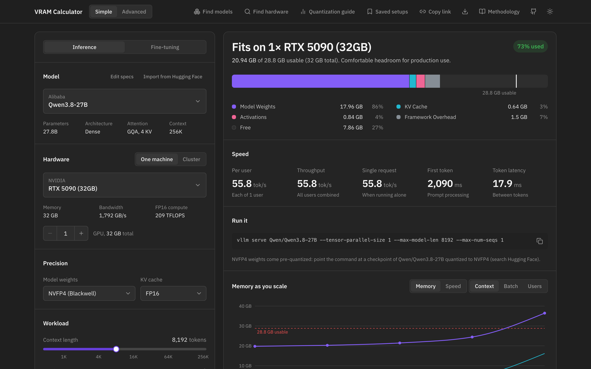
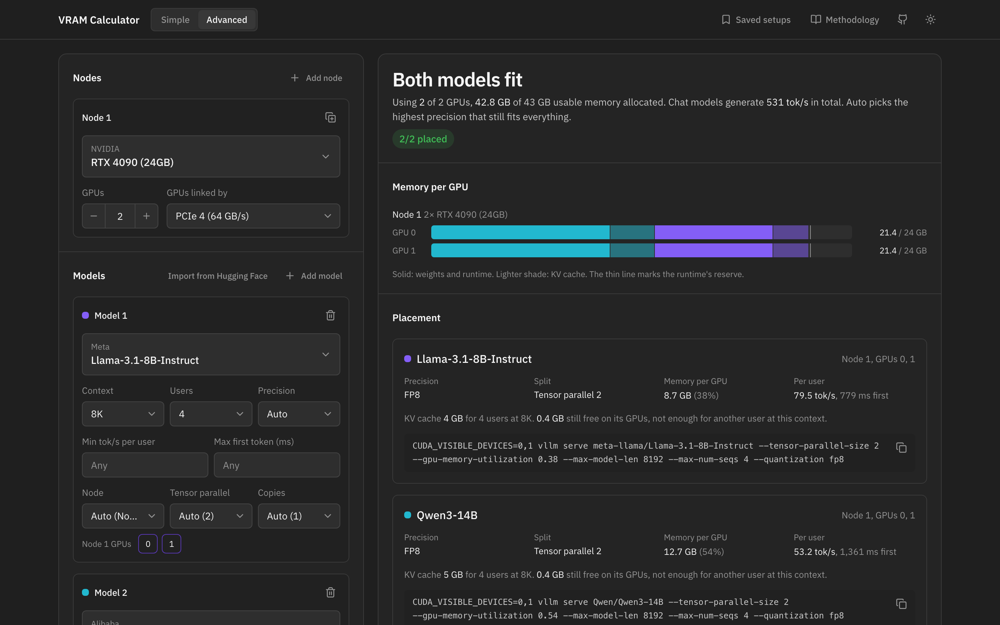

# VRAM Calculator

Check whether an LLM fits on your GPUs, how fast it will run, and get the command to launch it.

**[Open the calculator](https://vram-calculator.mariusbrt.com/)** | [How the numbers are made](https://vram-calculator.mariusbrt.com/methodology)



## What it does

- **Fit and speed**: memory part by part, speed per user and in total, time to first token and how many users fit,
  for 410 models on 125 GPUs from NVIDIA, AMD, Apple and Intel, or any model imported from Hugging Face.
- **Launch command**: ready to paste for vLLM, SGLang, TensorRT-LLM, llama.cpp, Ollama, Transformers or TEI, with
  speculative decoding, CPU offloading and KV cache precision.
- **Fine-tuning**: full, LoRA and QLoRA, with ZeRO and offloading, and the Unsloth, TRL or torchtune command.
- **Find models and Find hardware**: every model that fits your GPUs, or the cheapest GPUs that run a model.
- **Several models on your machines**: the Advanced view places a set of models on a pool of nodes, picking precision,
  tensor and pipeline parallelism and copies, with per-model speed targets.



Everything runs in your browser: no account, nothing stored on a server. Saved setups stay in your browser's storage.

## How accurate it is

Memory is counted part by part: weights, KV cache, activations, runtime overhead. Speed comes from the hardware: decoding
is limited by memory bandwidth and reading a prompt by compute. How close each runtime gets to the hardware's peak is
fitted to 123 published and contributed measurements, per GPU class.

| On a GPU left out of the fit | Typical error |
| --- | --- |
| Decode speed | about 10% |
| llama.cpp prompt processing | about 25% |
| TensorRT-LLM time to first token | about 7% |

Very large MoE models are on the optimistic side, and SGLang and Transformers aren't checked against measurements yet.
Every formula, constant and benchmark is on the [methodology page](https://vram-calculator.mariusbrt.com/methodology).

## Sources

**Data**

- Models: the [Hugging Face Hub API](https://huggingface.co/docs/hub/api) (each model's `config.json` and parameter
  count), refreshed every week.
- GPUs: vendor spec sheets for memory, bandwidth, tensor throughput and power, with rough cloud rental prices.
- Speed measurements: the llama.cpp scoreboards for [CUDA](https://github.com/ggml-org/llama.cpp/discussions/15013),
  [ROCm](https://github.com/ggml-org/llama.cpp/discussions/15021) and
  [Apple Silicon](https://github.com/ggml-org/llama.cpp/discussions/4167),
  [NVIDIA NIM benchmarks](https://docs.nvidia.com/nim/benchmarking/llm/1.0.0/performance.html),
  [SemiAnalysis InferenceX](https://github.com/SemiAnalysisAI/InferenceX) and contributed `vllm bench serve` runs.
  All rows are in [`benchmarks.json`](src/lib/data/benchmarks.json) with their links.

**Methods**

- Korthikanti et al., [Reducing Activation Recomputation in Large Transformer Models](https://arxiv.org/abs/2205.05198), 2022
- Rajbhandari et al., [ZeRO: Memory Optimizations Toward Training Trillion Parameter Models](https://arxiv.org/abs/1910.02054), 2020
- Hu et al., [LoRA](https://arxiv.org/abs/2106.09685), 2021, and Dettmers et al., [QLoRA](https://arxiv.org/abs/2305.14314), 2023
- Dao et al., [FlashAttention](https://arxiv.org/abs/2205.14135), 2022, and Kwon et al., [PagedAttention](https://arxiv.org/abs/2309.06180), 2023
- DeepSeek-AI, [DeepSeek-V2](https://arxiv.org/abs/2405.04434) (Multi-head Latent Attention) and [DeepSeek-V3](https://arxiv.org/abs/2412.19437) (multi-token prediction), 2024
- Leviathan et al., [Fast Inference from Transformers via Speculative Decoding](https://arxiv.org/abs/2211.17192), 2023
- Li et al., [EAGLE-3](https://arxiv.org/abs/2503.01840), 2025, and Chen et al., [DFlash](https://arxiv.org/abs/2602.06036), 2026
- On predicting LLM speed: [LIFE](https://arxiv.org/abs/2508.00904) (Patwari et al., 2025), [WattGPU](https://arxiv.org/abs/2607.02391)
  (2026), [GenZ](https://arxiv.org/abs/2406.01698) (Bambhaniya et al., 2024) and [Vidur](https://arxiv.org/abs/2405.05465) (Agrawal et al., 2024)

## Contribute a benchmark

Measurements from real servers make the estimates better. On the machine that serves the model, run the benchmark
script. It measures a running vLLM server, or a GGUF file with llama-bench, and writes a `report.md`:

```bash
curl -fsSLO https://raw.githubusercontent.com/Marius-brt/VRAM-Calculator/main/scripts/benchmark.sh
```

```bash
bash benchmark.sh --docker <container> --users 12
```

Leave out `--docker` when vLLM runs directly on the machine; `bash benchmark.sh --help` lists the options. Then paste the
report into a [benchmark issue](https://github.com/Marius-brt/VRAM-Calculator/issues/new?template=benchmark.yml).

Maintainers add the rows to [`benchmarks.json`](src/lib/data/benchmarks.json), refit and check the error on GPUs the
fit hasn't seen:

```bash
bun scripts/fit-speed.ts --write
```

```bash
bun scripts/fit-speed.ts --cv
```

## Run it locally

```bash
bun install
```

```bash
bun run dev
```

```bash
bun test
```

The engine is plain TypeScript in [`src/lib/calculator`](src/lib/calculator). The catalogs are JSON in
[`src/lib/data`](src/lib/data), rebuilt by two scripts:

- `python3 scripts/gpus.py` writes the GPU table; edit it in the script.
- `bun scripts/build-catalog.ts` rebuilds the models from Hugging Face. Set `HF_TOKEN` to read gated repos directly.
  It refuses to shrink the catalog by more than 20% (rate limits); `--force` overwrites anyway.

<details>
<summary>Deploy to GitHub Pages</summary>

The site is fully static. [`.github/workflows/pages.yml`](.github/workflows/pages.yml) builds it as a Next static
export under `/<repo>` and publishes it on every push to `main`, every Monday (to refresh the model catalog) and on
demand from the Actions tab.

1. In the repository settings, under Pages, set the source to GitHub Actions.
2. Optional: add an `HF_TOKEN` repository secret (a read token) for higher Hugging Face rate limits.

If the weekly refresh is throttled, the build keeps the committed catalog. GitHub pauses scheduled workflows after
60 days without commits to a public repository.

</details>

<details>
<summary>HTTP API (self-hosted only)</summary>

`bun run dev` or `bun run start` also serves stateless routes over the same engine and catalogs. They need a server,
so the GitHub Pages build leaves them out.

| Route | What it returns |
| --- | --- |
| `POST /api/v1/calculate` | Memory, speed and cost for one setup. Body: `{ calc_mode, gpu_key, model_variant, quantization, seq_length, concurrent_users, num_gpus, tp_degree, framework_preset, ... }` |
| `POST /api/v1/plan` | A pool plan. Body: `{ network, nodes: [{ id, gpuKey, count, link }], models: [{ id, model, contextLength, users, quant, target?, pin? }] }` |
| `GET /api/models?q=` | The model catalog, optionally filtered by name, provider or family. |
| `GET /api/gpus` | The GPU catalog. |

```bash
curl -s localhost:3000/api/v1/calculate -H 'content-type: application/json' -d "{\"calc_mode\":\"inference\",\"gpu_key\":\"4090_24\",\"quantization\":\"q4_k_m\",\"seq_length\":8192,\"num_gpus\":1,\"framework_preset\":\"llama_cpp\",\"model_variant\":$(curl -s 'localhost:3000/api/models?q=llama-3.1-8b-instruct' | jq '.[0]')}"
```

</details>

## Cite

If the calculator helps your work, please cite it. GitHub's "Cite this repository" button reads
[`CITATION.cff`](CITATION.cff).

```bibtex
@software{brouty_vram_calculator_2026,
  author = {Brouty, Marius},
  title  = {VRAM Calculator: memory and speed estimates for LLM inference and fine-tuning},
  year   = {2026},
  url    = {https://github.com/Marius-brt/VRAM-Calculator}
}
```

Made by [Marius Brouty](https://mariusbrt.com).
